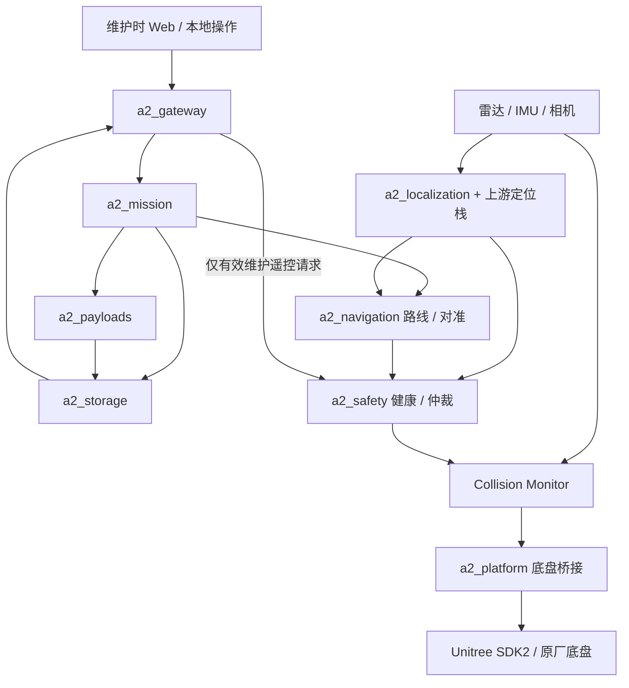

# 软件架构与项目结构

**架构基线 v0.5 · 2026-11-04**

本文确定代码组织、模块边界和启动模式。业务与验收要求见[完整设计方案](design/A2-PRO_Utility_Tunnel_Navigation_v0.5.md)，开发操作见[开发与实机验证流程](development.md)。当前已有任务与存储核心、ROS 只读链路、mock 任务服务和离线地图目标点规划。实机运动节点待实现。[实现进度](implementation-status.md)记录软件与实机验证范围。

包计划以 [`src/package-plan.json`](../src/package-plan.json) 登记，模式契约以 [`config/examples/profiles.json`](../config/examples/profiles.json) 登记；后者区分已实现的 mock 组合与仍在设计的其他 profile；mock 运行见[任务演示](mock-mission.md)，单独节点见[只读演示](platform-readonly.md)。

## 1. 架构决策

- 采用单仓库与 ROS 2 colcon 工作区。`src/` 保存自研包；上游代码通过依赖清单取得，位于忽略的 `third_party/src/`，不复制进自研包，也不提交第三方构建产物。
- 同一发布锁定同一 ROS 发行版、上游提交、消息定义和构建配置。本机为 x86_64，A2 Orin 为 ARM64；二者共享源码与接口，不共享平台二进制。实际 JetPack、系统与 ROS 组合通过 M0 确认。
- 平台桥接、运动仲裁、健康时序和点云适配使用 C++17；任务编排、载荷业务、存储与网关优先使用 Python 3，解释器版本随锁定 ROS 环境确定。厂商原生库由适配器封装，不向业务层暴露。
- 业务规则与 ROS/设备 I/O 分离。状态转换、路线进度、预算、去重和结果判定保持为可注入时钟、存储及设备端口的普通库，便于本机测试；ROS 节点仅承担消息转换和生命周期连接。
- 全程巡检由机载模块完成。网关连接状态不参与自主授权续期；底盘停车、控制失联处理及关键健康判定不依赖数据库事务或媒体线程。



图中的箭头表示运行数据流，不等同于源码依赖。所有自研运动请求均经仲裁、防撞和桥接；网关、任务与载荷不能调用 Unitree 运动 API。SDK2 是原厂客户端接口，真正的接收端失联停车能力仍须在 A2 验证。

## 2. 自研包边界

| 包 | 职责与实现语言 | 本机验证 | A2 验证 |
|---|---|---|---|
| `a2_interfaces` | 自研 `msg/srv/action`、枚举与接口版本；接口定义独立于业务实现 | 生成接口、序列化与契约检查 | 与锁定 ROS/上游消息兼容 |
| `a2_description` | 机身/传感器模型、坐标约定、标定加载；描述文件与启动配置 | TF 树、示例外参、模型加载 | 实际外参、载荷外廓、唯一 TF 发布者 |
| `a2_platform` | 底盘状态、IMU/相机接入适配、Unitree SDK2 桥接；C++17 | 通过无 SDK 的模拟端口验证映射与超时逻辑 | ARM64 链接、状态读取、受限运动及失联停车 |
| `a2_localization` | 点云/时钟/位姿适配、地标质量、定位健康；C++17，组合 DLIO/RTAB-Map/AprilTag | 录包回放、去畸变、TF、健康状态 | 实时负载、标定、定位精度与失锁 |
| `a2_navigation` | 固定路线执行、进度、桩前对准；C++17，组合 Nav2 Controller/RPP | 参考路径、跳段检测、假动作服务 | 路线跟踪、桩前误差、障碍暂停 |
| `a2_safety` | 授权仲裁、速度约束、健康汇总、防撞配置；C++17，组合 Collision Monitor | 事件优先级、过期/旧授权拒绝 | 检测到停稳、方向外廓和故障注入 |
| `a2_mission` | 任务包准入、任务状态机、点位调度、低电与等待预算；Python 3 | 纯业务规则、模拟设备和崩溃恢复 | 全程离线、低电/堵路组合场景 |
| `a2_payloads` | 云台抓拍、气体采样与诊断；Python 3，必要的 SDK 封装用 C++17 | 模拟设备、动作未知/重试、时间关联 | 实机协议、拍摄质量、气体有效性 |
| `a2_storage` | SQLite 事务、媒体提交、检查点、事件与同步水位；Python 3 | 掉电边界、幂等、满盘及文件对账 | 实际存储介质时延、容量、断电恢复 |
| `a2_gateway` | WSS/HTTPS、维护会话、任务准备与结果补传；Python 3 | 模拟后端、重复请求、旧会话拒绝 | 维护联网、断连不影响自主、补传 |
| `a2_bringup` | 组合节点、配置层级、启动 profile、生命周期与依赖检查 | 组合检查、默认模拟、错误配置拒绝 | 机内网络、启动/关闭顺序和进程恢复 |
| `a2_test_support` | 假设备、故障注入、合成数据和回放适配；Python 3 / C++17 | mock / replay 测试环境 | 不进入真机运行 profile 或部署清单 |

包内后续采用 `include/<package>/`、`src/`、`test/` 的 C++ 布局，或 `<package>/`、`test/` 的 Python 布局；存在实际实现时才添加对应 `package.xml`、构建文件与入口。不会用仅能构建的空节点表示功能已完成。

## 3. 依赖与接口约束

源码依赖方向为“标准 ROS/第三方库 → `a2_interfaces` 与独立规则库 → 各能力包 → `a2_bringup`”。`a2_interfaces` 只依赖必要的标准消息，不导入任何能力包。能力包通过公共接口通信，不相互导入节点实现；任务管理器不链接 SDK2，网关不导入平台桥接实现。`a2_test_support` 可以依赖公共接口和可测试规则库，生产包不能反向依赖测试支持包。

| 边界 | 交互类型与约定 |
|---|---|
| 任务准备/授权/启动/暂停/取消/返桩 | 请求与受理结果携带 `request_id`、`mission_id`；最终状态另以持久化事件报告。受理不等于已运动。 |
| 导航、抓拍、对准 | 可取消的 ROS 2 action；保留 `action_id`、阶段、最终结果和 `UNKNOWN`，不能把取消请求送达当成停稳。 |
| 传感器与定位 | 标准点云、IMU、图像、里程计和 TF；适配后的采集时刻、坐标系及有效性明确，禁止用接收时刻冒充采集时刻。 |
| 健康与运动许可 | 专用状态话题；包含 `boot_id`、`control_epoch`、来源、序号、单调时间和失效条件。过期状态不能维持授权。 |
| 速度链路 | 各来源独立请求 → 仲裁输出 → Collision Monitor 输出 → 桥接；仅桥接是自研 SDK 运动调用出口。标准速度消息与许可代号的绑定由适配层保持。 |
| 持久化与成果 | 业务动作先取得持久化确认再派发；停车、撤权和取消的停止部分走独立快速通道，随后尽力记录。 |
| Web | 仅映射白名单任务命令、维护遥控请求和数据同步，不透传任意 ROS 话题或服务。 |

初始内部命名使用 `/a2/...` 命名空间，分别划分 `sensors`、`localization`、`mission`、`payloads`、`safety`、`platform` 与 `events`；具体名称、频率、QoS 与上游重映射在接口文件和配置中统一定义。关键控制消息不使用用于跨重启恢复命令的持久化传输；传感器 QoS 则以生产者兼容和实测时延为准。

TF 唯一职责：RTAB-Map 发布 `map → odom`；`a2_localization` 位姿适配发布 `odom → base_footprint → base_link`；`a2_description` 选择唯一发布器加载机身与传感器固定外参。上游 DLIO 重复 TF 必须关闭。云台活动关节由实际角度反馈驱动，不能按固定外参处理。

SQLite 由 `a2_storage` 单一写入服务管理，调用使用有界队列和超时。任务状态与持久化收据由明确接口提交，其他包不得各自直接改库。存储不可用触发任务故障，但停车线程保持独立；进程边界和资源限制在 A2 负载测试中确认。

## 4. 四种启动 profile

| profile | 允许输入/输出 | 约束 |
|---|---|---|
| `mock`（默认） | 合成传感器、假设备、内存或临时数据目录 | 不加载 SDK2、不创建设备控制客户端、不连接机器人网卡；用于业务与接口测试。 |
| `replay` | 经清单选择的录包传感器、时间和 TF，输出仅到测试消费者 | 使用回放时间并隔离命名空间；不重放速度、授权、任务启动或 SDK 命令；不加载真机桥接。 |
| `robot_readonly` | A2 实际传感器和底盘状态，只读诊断与录包 | 不实例化运动写入客户端；即使存在速度话题也不能发出底盘运动命令。 |
| `robot_motion` | 已验收配置、实际传感器、完整授权与停车链路 | 仅在 A2 显式选择；需现场准入、本地新授权和原厂已释放控制权。缺条件则拒绝进入运动。 |

profile 是部署组合白名单，不是单个 `enable_motion=false` 参数。模拟/回放包与真实 SDK 依赖分别构建和装载；`robot_readonly` 不因参数变化变成运动模式。`robot_motion` 部署清单排除 `a2_test_support`，模式切换须先停机并重建节点组合。

本机开发使用独立 ROS domain、回环发现范围和容器/网络隔离；机器人使用明确的机内 DDS 配置。domain 与命名空间用于减少误发现，不作为唯一运动保护。维护 SSH 连接只用于传输和诊断，不等于运动授权；现场作业时移除外部通信仍须完成任务。

启动顺序为：校验发布清单与 profile → 平台只读接入及模型 → 感知/定位 → 健康与防撞 → 任务/载荷/存储 → 网关（可缺席）→ 自检与定位达标后现场授权。桥接可先启动以验证下游停车能力，但始终保持无运动授权，直到依赖全部就绪。ROS 生命周期能力不足的上游节点由进程监督与就绪探针适配，不假设每个驱动都支持相同生命周期。

退出或切换前先撤销运动许可并验证停稳，再停止业务和非关键模块，最后关闭防撞与桥接。关键进程异常或重启撤销其依赖的运动授权，重启不恢复旧许可；网关重启只影响自身同步/维护会话。整个 Orin 消失后的停车仍由已验证的底盘侧机制承担。

## 5. 项目目录与配置分层

```text
A2_project/
├── README.md                       # 当前入口与实现状态
├── docs/
│   ├── design/                     # 当前权威设计 v0.5
│   ├── archive/                    # 历史方案，只供追溯
│   ├── architecture.md             # 软件边界与目录决策
│   ├── development.md              # 本机开发与 A2 验证
│   └── github-setup.md              # 建库准备与推送流程
├── src/
│   ├── package-plan.json            # 自研包计划与实现状态
│   ├── a2_interfaces/              # 公共接口
│   ├── a2_description/             # 模型与 TF 配置
│   ├── a2_platform/                # 硬件接入和唯一 SDK 运动出口
│   ├── a2_localization/            # 感知定位适配
│   ├── a2_navigation/              # 固定路线和桩前对准
│   ├── a2_safety/                  # 健康、仲裁、防撞配置
│   ├── a2_mission/                 # 离线任务编排
│   ├── a2_payloads/                # 云台、相机、气体
│   ├── a2_storage/                 # SQLite 与媒体
│   ├── a2_gateway/                 # 维护连接和成果同步
│   ├── a2_bringup/                 # profile 和组合启动
│   └── a2_test_support/            # 模拟/回放专用
├── third_party/
│   ├── dependencies.repos          # 上游依赖清单，发布前锁定提交
│   └── src/                        # 拉取的上游源码，不提交
├── config/
│   ├── examples/                   # 合成、无现场数据的示例
│   │   └── profiles.json           # 四种模式的设计契约
│   └── local/                      # 现场参数/标定/凭据，不提交
├── deploy/
│   ├── templates/                  # 发布及运行配置模板
│   └── local/                      # 实机部署实例，不提交
├── docker/development/             # 本机候选开发环境
├── scripts/                        # 仓库检查、构建与发布辅助
├── tests/{unit,integration,replay,hil}/
├── data/                           # 录包、地图、成果、证据，不提交
└── .github/                        # CI、Issue 与 PR 模板
```

配置分为公共示例、经过验收的现场配置和运行状态。现场配置生成不可变快照后进入发布包；运行时不直接修改 Git 中的示例。SQLite、照片和任务进度位于运行数据目录，独立于代码发布目录；软件回退不能回退已消费授权和业务记录。

正式 `third_party/dependencies.repos` 仍保留空 `repositories`，M0 逐项确认后登记已核实依赖。[建图候选清单](../third_party/mapping-candidate.repos)单独锁定本机试验版本，其中 DLIO 固定版本已完成 Jazzy/x86_64 候选构建；候选构建不代表正式全栈依赖或 A2 已验收，准备范围与输入适配限制见[建图准备状态](mapping-readiness.md)。

四类版本分别使用：源码 `source_commit` 定位实现；`map_version` 定位地图坐标与地图数据；`config_version` 定位标定、路线、阈值与策略；`bundle_id` 汇总一次发布/任务所绑定的文件清单及兼容关系。发布清单再记录架构、ROS/系统、依赖提交与产物摘要。构建通过不等于配置通过验收，修改任一关联项都需评估受影响用例。

## 6. 实施顺序与当前边界

A2 已完成维护连接和原装前雷达、IMU 的断网采集。本机已隔离回放实机环线录包并生成地图及闭环候选。原装摄像头可用，新增巡检载荷尚未安装。mock 启动组合已实现，实机安全控制与其他正式 profile 待实现，M0 未关闭。[实现进度](implementation-status.md)

1. 保留已实现的任务/存储核心与 mock 闭环。更换机器人或配置时，按[录包指南](mapping-capture.md)核查 A2 系统、原装传感器话题、点内时间、IMU、外参、TF 和 QoS，先用短包确认数据，再采集代表性路线。采集工具只读观察，运动采集由现场人员使用原厂方式受控操作。
2. 根据实测输入核实数据适配和候选依赖，在本机加载对应候选 overlay 并隔离回放。继续验证场地覆盖、地图几何和重定位，再联调定位健康与固定路线进度。[建图准备与回放边界](mapping-readiness.md)
3. 取得底盘失效停车证据后实现并验证仲裁、防撞、桥接的唯一运动链路，再开放受限运动 profile。
4. 新增云台、气体等巡检载荷安装后再接入，按完整方案 M0–M4 逐步集成载荷、返桩与离线全程；其缺席不阻塞原装传感器建图验证，不以本机 CI 或 ARM64 编译成功代替实机验收。

仓库检查验证目录、文档和配置约定；CI 另运行任务/存储核心测试、合成演示，以及不含 SDK 的 Jazzy 只读构建/测试。后续增加实际包时，应同时提交接口契约、对应测试与 profile 依赖清单；在这些实现完成前，本文中的启动模式和节点流程均是待实现的设计要求。
